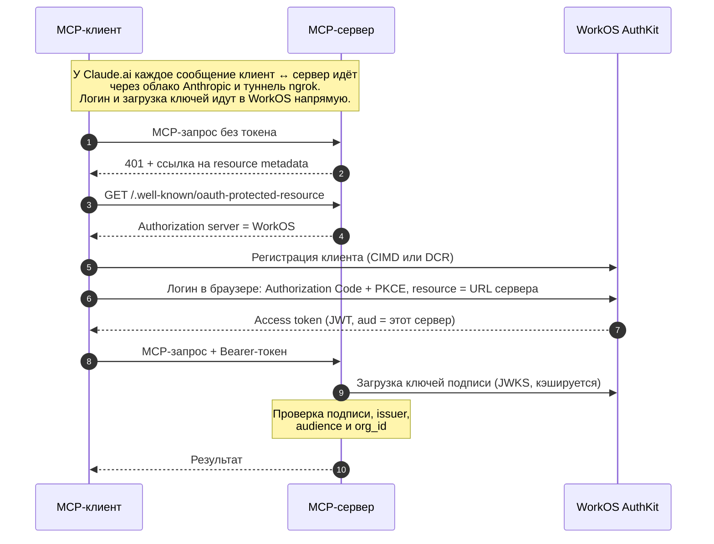

# OAuth: техническое описание

> Дополняет `PLAN.md`. Статус: **M4 — WorkOS AuthKit** и **M6 — Claude.ai
> через ngrok** реализованы и проверены (Inspector, Claude Desktop,
> Claude.ai). **M5 — Entra ID** — исследовано, не начато.

## Архитектура

- **Authorization Server = внешний IdP** (WorkOS сейчас, Entra ID в M5).
  Только он видит пароли, показывает форму логина, выпускает токены.
- **Resource Server = наш MCP-сервер.** Только проверяет токен (подпись,
  issuer, audience) и обслуживает запрос. Паролей не хранит, токенов не
  выпускает.

Свой OAuth-сервер не пишем: доверяем внешнему IdP и проверяем его подписи.
Роль сервера одинакова для любого провайдера, меняются только endpoints и
claims.

## Как клиент подключается

1. Клиент обращается к серверу без токена → `401` и заголовок
   `WWW-Authenticate` со ссылкой на Protected Resource Metadata.
2. Клиент читает `/.well-known/oauth-protected-resource` (RFC 9728,
   обязателен по спеке MCP 2026-07-28): «я ресурс, мне доверяет такой-то
   Authorization Server».
3. Клиент берёт discovery-документ IdP и узнаёт его endpoints.
4. Клиент регистрируется у IdP (CIMD или DCR) и открывает в браузере логин:
   Authorization Code + PKCE (обязателен в OAuth 2.1). Наш сервер этого не
   видит.
5. IdP выпускает JWT, привязанный к нашему серверу через параметр
   `resource` (RFC 8707): `aud` = адрес сервера.
6. Клиент шлёт `Authorization: Bearer <token>` в каждом запросе, сервер
   проверяет токен **локально** по ключам IdP (JWKS, кэшируются).



## Код (`Program.cs`): что важно и не очевидно из документации

- **SDK WorkOS не нужен.** Достаточно стандартного `AddJwtBearer` с
  `Authority` = домен AuthKit: AuthKit ведёт себя как обычный OAuth 2.1 /
  OIDC-провайдер с JWKS. SDK `WorkOS.net` нужен только для Admin API.
- **Две схемы в `AddAuthentication`:** MCP-схема (`.AddMcp(...)` из
  namespace `ModelContextProtocol.AspNetCore.Authentication` — отдельного
  NuGet-пакета нет) как challenge scheme — публикует PRM и формирует
  правильный `401`; JWT Bearer — как схема проверки токена.
- **`app.MapMcp()` сам по себе эндпоинт не защищает.** `[Authorize]` на
  классах tools/resources/prompts с `AddAuthorizationFilters()` работает
  только внутри JSON-RPC: без токена клиент получает «мягкий» отказ
  (`200 OK` с пустым списком), а OAuth-флоу клиенты запускают только на
  HTTP `401`. Нужно `app.MapMcp().RequireAuthorization()`.
- **`ResourceMetadata.ScopesSupported`** — только те scope, которые
  принимает `/oauth2/authorize` AuthKit: `openid`, `profile`, `email`,
  `offline_access`. Кастомные (`Mcp.Read` и т.п.) ломают логин с
  `invalid_scope`. `AuthorizationServers` — `ICollection<string>`, не `Uri`.
- **Audience обязательно проверять.** `ValidAudiences` берётся из
  `WorkOS:Audiences` в `appsettings.json` — по одному значению на каждый
  resource indicator в WorkOS, **со слэшем на конце** (так выглядит `aud`
  в токене, в отличие от `resource` в PRM). Без проверки сервер принял бы
  токен, выпущенный для любого другого ресурса того же WorkOS-проекта
  (confused deputy).
- **`UseForwardedHeaders` (`X-Forwarded-Proto`, `X-Forwarded-For`)** нужен
  за туннелем. SDK строит адреса в PRM и `WWW-Authenticate` из входящего
  запроса, а ngrok шлёт на localhost обычный `http` — без заголовка сервер
  опубликовал бы `http://…`, и клиент отверг бы несовпадение. Исходный
  `Host` ngrok сохраняет, поэтому `X-Forwarded-Host` не нужен. Доверяются
  только loopback-прокси (дефолт ASP.NET Core).
- Tool-методы могут принимать `ClaimsPrincipal` (SDK подставляет сам) —
  так из метода доступны claims токена.

## Доступ: почему `org_id`, а не read/write

Задумывалось разделение по чувствительности: `Mcp.Write` для 4 команд,
`Mcp.Read` для остального. **На WorkOS это невозможно:** роли и permissions
(`mcp.read`/`mcp.write`, назначенные через Role + Organization membership)
WorkOS кладёт только в свой внутренний session JWT, а не в access token
стороннего клиента. Проверено на реальном токене (временное логирование в
`OnTokenValidated`): там есть `iss`, `aud`, `sub`, `org_id`, `scope`, но нет
ни `permissions`, ни `role`. Документация WorkOS это подтверждает.

**Решение:** одна policy `organizationMember` — валидный токен **и**
`org_id` = `WorkOS:OrganizationId`. Это default policy для всего эндпоинта,
на неё же указывают `Mcp.Read`/`Mcp.Write` (атрибуты на классах оставлены
как выражение намерения). Зачем: в AuthKit включён self-service sign-up, и
с публичным URL любой мог бы зарегистрироваться и получить доступ к данным.
`org_id` — единственный claim о членстве, который доходит до токена.
Пользователь вне организации получает `403`. Вживую это ещё не
проверялось: нужен второй пользователь AuthKit вне организации.

В M5 проверить: в Entra ID App Roles должны попадать прямо в `roles`
claim токена любого клиента — тогда разделение read/write может
заработать там.

## Настройка WorkOS Dashboard

- **Overview / Quickstart** → `WORKOS_API_KEY`, `WORKOS_CLIENT_ID`
  (секретные, см. «Секреты»).
- **Domains** → AuthKit domain (не секретный, в `appsettings.json` как
  `WorkOS:AuthKitDomain`).
- **Connect → Configuration:**
  - **DCR** — включить: нужен клиентам без заранее выданного client id
    (Inspector, `mcp-remote`).
  - **CIMD** — работает для Claude.ai (его metadata-документ хостит
    Anthropic), но не для локальных клиентов: им негде опубликовать свой
    документ. AuthKit объявляет поддержку CIMD в
    `/.well-known/oauth-authorization-server`
    (`client_id_metadata_document_supported: true`); включается ли это
    отдельным флагом в дашборде, не выяснено.
  - **MCP resource indicators** — адреса сервера по RFC 8707. WorkOS
    принимает несколько: сейчас `http://localhost:5094/` и адрес туннеля.
    **Default indicator не нужен:** Inspector, `mcp-remote` и Claude.ai
    сами передают `resource`. «External Sign-in URI» к нам не относится.
- **Authorization → Roles & Permissions:** permissions `mcp.read`/
  `mcp.write` (WorkOS приводит имена к нижнему регистру) и роль
  `financetrackeruser`. На доступ сейчас не влияют — см. выше.
- **Organizations:** WorkOS сам создаёт «Test Organization». Пользователя
  нужно добавить в неё (Dashboard → Organizations → Members или Admin API
  `POST /user_management/organization_memberships`) — без этого в токене
  нет `org_id`.
- **Users:** тестовый пользователь регистрируется сам на hosted-странице
  логина AuthKit (кнопка Sign up). Это отдельный аккаунт, не связанный с
  логином разработчика на workos.com.

## Секреты

`WorkOS:ApiKey` и `WorkOS:ClientId` — только в .NET User Secrets
(`%APPDATA%\Microsoft\UserSecrets\<guid>\secrets.json`), никогда не в
`appsettings.json` или git. Серверу для работы они не нужны — только для
ручных вызовов Admin API. Задать (в папке `Mcp.FinanceTracker.Server`):

```
dotnet user-secrets set "WorkOS:ApiKey" "<из WorkOS Dashboard → Quickstart>"
dotnet user-secrets set "WorkOS:ClientId" "<из WorkOS Dashboard → Quickstart>"
```

`dotnet user-secrets list` выводит значения целиком — не запускать на
общем экране и не выводить в лог инструментов.

**Открытый security-TODO:** однажды `user-secrets list` вывел
`WorkOS:ApiKey` в лог инструмента. Ключ считать скомпрометированным:
Dashboard → API Keys → Regenerate, затем `user-secrets set`. Не выполнено.

## Клиенты

### MCP Inspector

`npx @modelcontextprotocol/inspector`, транспорт Streamable HTTP, URL
вводится вручную (`http://localhost:5094` или адрес туннеля). Ходит к
серверу через свой node-прокси, поэтому страница-предупреждение ngrok ему
не мешает. Шаблоны ресурсов поддерживает.

### Claude Desktop

Два способа подключения, работают одновременно:

- **Локально, без туннеля:** `claude_desktop_config.json` + мост
  `mcp-remote`. Для Desktop это обычный локальный stdio-сервер, поэтому
  работает, несмотря на фразу в документации Anthropic, что remote-серверы
  из JSON не подключаются.

  ```json
  "mcpServers": {
    "finance-tracker": {
      "command": "npx",
      "args": ["-y", "mcp-remote", "http://localhost:5094/"]
    }
  }
  ```

  При установке из MSIX конфиг лежит в
  `%LOCALAPPDATA%\Claude-Data\claude_<id>\`, а не в `%APPDATA%\Claude\`.
  Править только при полностью закрытом Desktop, иначе он перезапишет файл.
- **Через аккаунт:** коннектор, добавленный в Claude.ai, сам появляется в
  Desktop. Идёт через облако Anthropic и туннель.

Если включены оба, модель видит каждый tool дважды — оставлять один.

Что видно в режиме **Chat:** tools вызываются моделью; prompts и
статичный ресурс `Accounts` — в «+» → Connectors → «Add from …».
**Шаблоны ресурсов не поддерживаются:** Desktop не вызывает
`resources/templates/list`. Сервер под это не подгоняем — те же данные
модель получает через tools.

Режим **Cowork / Code** открывает отдельное подключение и загружает только
tools. Его первое подключение может упасть с `Request timed out`, пока
пользователь проходит логин, — потом переподключается само.

### Claude.ai

Подключается **из облака Anthropic**, поэтому нужен публичный HTTPS-адрес
(туннель). Customize → Connectors → Add custom connector, URL туннеля:

- **Authentication: Sign in now** — Claude определяет сам («Detected»).
- **OAuth client: Use Claude's published identity (CIMD)** — сработал.
  Предпочтительный способ по спеке 2026-07-28 (DCR депрекейтнут), не
  плодит регистрации клиентов в WorkOS. Запасной вариант — Register
  automatically (DCR).

Наблюдения по трафику:
- Сначала разведка из бэкенда Anthropic (`User-Agent: python-httpx`):
  `initialize` → `401` → чтение PRM. По ней заполняются «Detected».
- Рабочие запросы (`User-Agent: Claude-User`) начинаются не с
  `initialize`, а с **`server/discover`** — видимо, механизм спеки
  2026-07-28; SDK 2.2.0 его поддерживает. Подробно не исследовалось.
- `resources/templates/list` не вызывается, как и в Desktop.
- **Claude.ai видит локальный сервер Desktop**, пока Desktop запущен на
  этой машине (функция удалённого устройства): в Settings → Connectors его
  нет, но в чате есть, и Claude может выбрать его вместо туннеля. Чтобы
  гарантированно идти через туннель, закрыть Desktop.
- Даты для tools Claude выбирает сам, если период не указан в вопросе, —
  для воспроизводимого результата указывать период явно.

### ngrok (туннель)

- Агент — из Microsoft Store или с сайта ngrok, **не** winget-пакет
  `Ngrok.Ngrok` (ngrok предупреждает, что он устарел).
- Authtoken вводить самому в отдельном терминале
  (`ngrok config add-authtoken <token>`), не через чат. Хранится в
  `%LOCALAPPDATA%\ngrok\ngrok.yml`.
- Бесплатный план: **один постоянный dev-домен** на аккаунт (на
  `.ngrok-free.dev`), не меняется между перезапусками — WorkOS и конфиг
  настраиваются один раз. 20 тыс. запросов и 1 ГБ в месяц, без лимита по
  времени. Запуск: `ngrok http 5094`.
- Страница-предупреждение ngrok показывается только браузерному
  HTML-трафику; Claude.ai и Inspector её не получают.
- Пока туннель запущен, сервер доступен из интернета — защищают его логин
  AuthKit и проверка `org_id`.

## Диагностика

- **Клиент не запускает логин:** `curl -i` без токена. `200 OK` без
  `WWW-Authenticate` → нет `.RequireAuthorization()` на `MapMcp()`. Через
  туннель ожидаем `401` с `resource_metadata="https://…"`.
- **Что в токене:** временно логировать claims в
  `JwtBearerOptions.Events.OnTokenValidated` — надёжнее, чем гадать по
  документации.
- **Почему отказ:** причины (`IDX10214` и т.п.) по умолчанию не пишутся.
  Временно добавить в `appsettings.Development.json`
  `"Microsoft.AspNetCore.Authentication": "Information"` (и
  `...Authorization`) — подхватывается без перезапуска.
- **Что запросил клиент:**
  - через туннель — журнал ngrok, `http://127.0.0.1:4040` или
    `/api/requests/http`: метод JSON-RPC, аргументы, статус, User-Agent;
  - Claude Desktop — `%LOCALAPPDATA%\Claude\logs\mcp-server-finance-tracker.log`:
    весь OAuth-флоу `mcp-remote` и каждый JSON-RPC метод.
- **«Залипший» кэш OAuth на клиенте** (после изменения auth-настроек
  сервера):
  - `mcp-remote` — `~/.mcp-auth/mcp-remote-v1/`, удалить файлы вручную;
  - Inspector раньше хранил discovery-документ в
    `~/.mcp-inspector/storage/oauth.json` (ключ — URL сервера, удаление
    сервера в UI не помогает). Новые версии пишут `Secrets: OS keychain` —
    где кэш сейчас, не проверялось.
- **WorkOS Admin API** — проверять членство и роли напрямую:
  `GET /user_management/organization_memberships?user_id=…`,
  `GET /organizations`, `GET /organizations/{id}/roles` (отдельного
  `/roles` нет).

## M5 — Entra ID (план)

- **Пакеты обновлять не нужно:** C# SDK начиная с 2.0.0 уже соответствует
  спеке MCP 2026-07-28 (она и переписала авторизацию) и сам согласует
  старые версии протокола вплоть до `2024-11-05`, если клиент их просит.
  Добавить нужно только `Microsoft.Identity.Web` →
  `AddMicrosoftIdentityWebApi(...)`.
- **Регистрация клиента:** Entra ID поддерживает DCR/CIMD ограниченно —
  реалистичный путь, вероятно, заранее созданный App Registration.
  Проверить при реализации.
- **Вручную в Azure Portal:** App Registration, identifier URI
  (`api://<client-id>`), scopes `Mcp.Read`/`Mcp.Write`.
- **Проверить первым делом:** попадают ли App Roles в `roles` claim токена
  стороннего клиента — от этого зависит разделение read/write.

## Источники

- [The biggest MCP spec update ships July 28 — WorkOS](https://workos.com/blog/mcp-2026-spec-agent-authentication)
- [Understanding Authorization in MCP — Model Context Protocol](https://modelcontextprotocol.io/docs/2026-07-28/tutorials/security/authorization)
- [Model Context Protocol — AuthKit — WorkOS Docs](https://workos.com/docs/authkit/mcp)
- [Dynamic Client Registration (DCR) in MCP — WorkOS](https://workos.com/blog/dynamic-client-registration-dcr-mcp-oauth)
- [Roles — User Management — WorkOS Docs](https://workos.com/docs/user-management/roles)
- [Sessions — access token — WorkOS Docs](https://workos.com/docs/user-management/sessions/integrating-sessions/access-token)
- [.NET MCP Server OAuth with Microsoft Entra ID — Mitchell Barry](https://blog.mitchbarry.com/net-mcp-server-oauth-with-microsoft-entra-id/)
- [Add Authentication to MCP Servers using Microsoft Entra ID — N+1 Blog](https://nikiforovall.blog/dotnet/2025/09/02/mcp-auth.html)
- [Securing Remote MCP Servers in C# — devleader.ca](https://www.devleader.ca/2026/07/23/securing-remote-mcp-servers-in-c-oauth-20-jwt-and-protected-resource-metadata)
- [Releases · modelcontextprotocol/csharp-sdk](https://github.com/modelcontextprotocol/csharp-sdk/releases)
