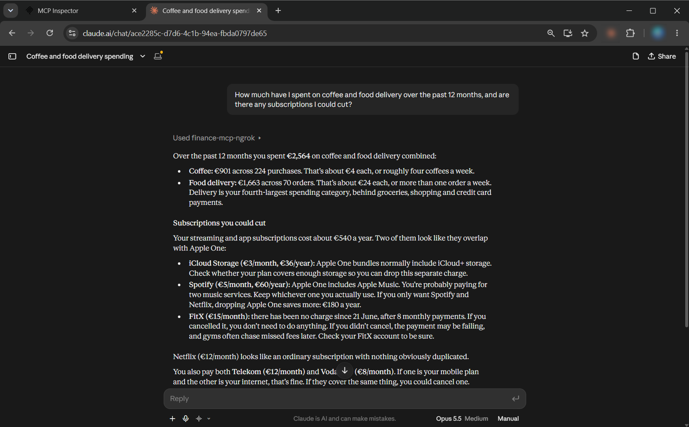
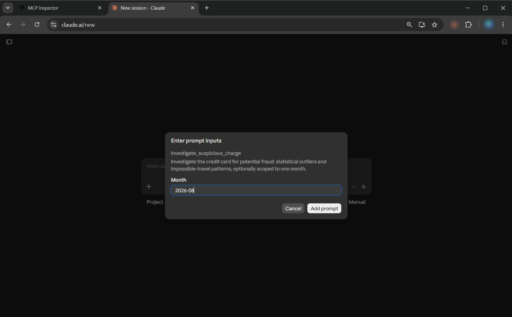
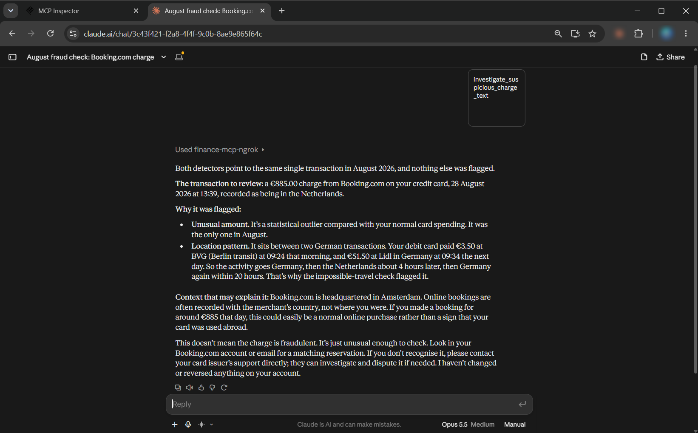
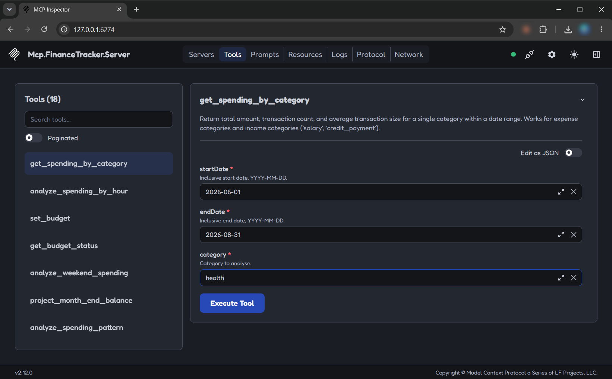
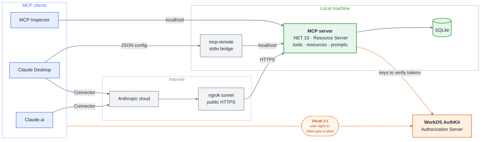

# Personal Finance MCP Server

A remote **Model Context Protocol (MCP)** server in **.NET 10** that lets AI
assistants such as Claude work with personal finance data: analyze spending,
review subscriptions, check suspicious charges and record transactions.
Access is protected by **OAuth 2.1**. Works with **Claude.ai**, **Claude
Desktop** and **MCP Inspector**.

## What it does

The server provides all three MCP building blocks:

| Primitive | Who uses it | What this server offers |
|---|---|---|
| **Tools** | The model | Balance, budget status, spending by category and merchant, spending patterns by weekday and time of day, subscription detection, savings simulation, month-end forecast, suspicious transaction detection, adding, categorizing and reversing transactions, setting a budget |
| **Resources** | The user or client | List of accounts, balance of one account, transactions for one month |
| **Prompts** | The user | Monthly financial review, suspicious charge investigation |

## Usage examples

The screenshots use a generated demo database, not real financial data.

**A question in plain language (Claude.ai).** Claude decides which tools to
call, combines their results, and reasons over the data: it spots
subscriptions that overlap and one that has stopped charging.

**A prompt picked from the menu (Claude.ai).** The user starts the
suspicious charge investigation and chooses a month.

The prompt tells Claude to run the fraud detectors and stay calm: flag the
charge as unusual, give a possible innocent explanation, and send the user
to their card issuer instead of acting on its own.

**MCP Inspector.** The protocol-level view: every tool with an input form
generated from its parameter schema.

## Architecture

Solid grey arrows: MCP requests. Dashed orange arrows: OAuth.

- **MCP server** (this project) is the OAuth **Resource Server**: it checks
  the access token on every request and never sees passwords.
- **WorkOS AuthKit** is the **Authorization Server**: it authenticates the
  user on its login page and issues access tokens.
- **Claude.ai** connects from Anthropic's cloud, so it reaches the server
  through a public **ngrok** tunnel. Local clients use `localhost`.

## Design decisions

- **Standard JWT validation, no vendor SDK.** Tokens are validated by
  standard ASP.NET Core authentication against WorkOS's public keys. The
  server does not depend on the WorkOS SDK.
- **One server for local and cloud clients.** The code has no per-client
  logic: the same process serves `localhost` and the public tunnel.
- **Access limited to one organization.** WorkOS puts no roles or
  permissions into tokens for third-party clients (checked on real
  tokens), so the server requires the organization claim (`org_id`).
  Without it, anyone who signed up on the login page could reach the data.

## Project structure

| Project | Purpose |
|---|---|
| `Mcp.FinanceTracker.Server` | ASP.NET Core host: MCP tools, resources and prompts, OAuth |
| `Mcp.FinanceTracker.Data` | Data access and analytics over SQLite |
| `Mcp.FinanceTracker.DataGen` | Generator of the demo transaction dataset |

## Tech stack

- **.NET 10 / ASP.NET Core**
- **Official MCP C# SDK** (`ModelContextProtocol.AspNetCore`), Streamable
  HTTP transport
- **OAuth 2.1 / OpenID Connect**: WorkOS AuthKit, ASP.NET Core JWT bearer
  authentication
- **SQLite** via ADO.NET (`Microsoft.Data.Sqlite`), no ORM
- **ngrok** for a public HTTPS address during development
